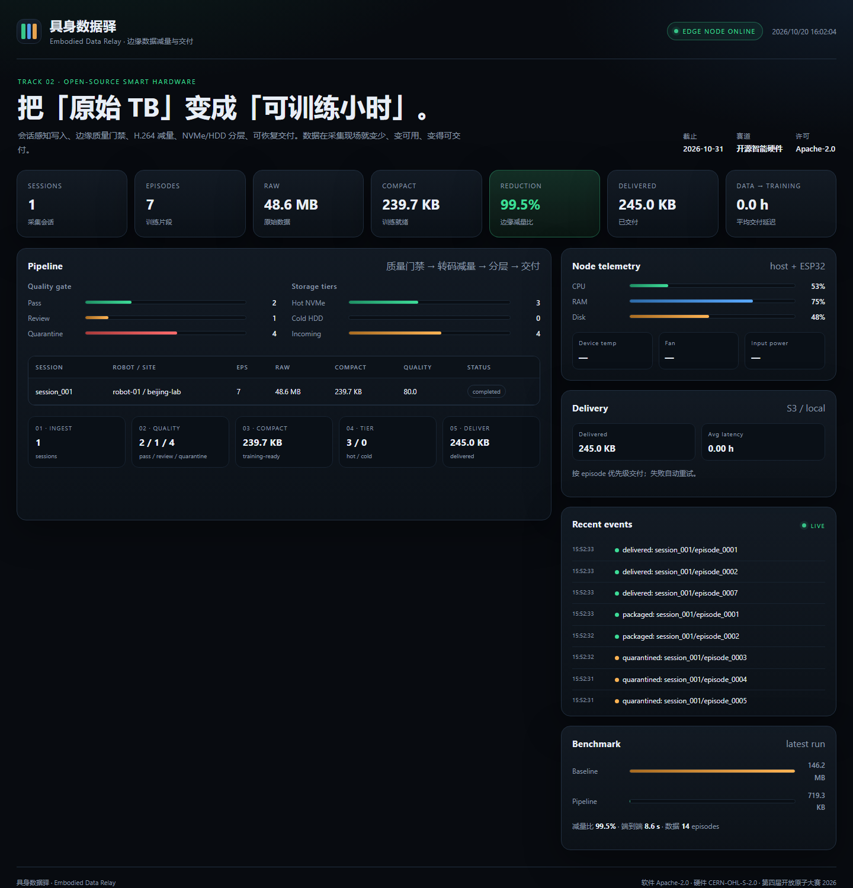

# 具身数据驿 · Embodied Data Relay

**让具身数据在采集现场就变少、变可用、变得可交付。**

具身智能的数据采集现场正在被三件事拖住：原始数据量太大、可用率太低、上传交付太慢。具身数据驿是一台开源的边缘数据站：在采集现场完成会话级无损写入、质量门禁、训练格式压缩、热冷分层和可恢复交付，把「原始 TB」变成「可训练小时」。

> 参赛项目：第四届开放原子大赛·2026 开源行业解决方案创新赛，赛道二「开源智能硬件解决方案」。
> 状态：MVP 已可运行，2026-10-31 提交。



## 问题

- 一个采集现场每天产生 TB 级多模态数据；8 路 1080p RGB 未压缩约 1.5 GB/s。
- 行业口径：原始素材约只有三成能进入训练，大量存储和带宽花在不可用数据上。
- 1 TB 数据走 100 Mbps 上行约 22 小时，10 Mbps 约 9 天；采集现场通常没有专线。
- 通用 NAS + SSD 缓存（bcache/dm-cache/ZFS L2ARC）不感知录制会话，顺序写默认绕过缓存，writeback 还有掉电丢数据风险。

## 方案

```
机器人/采集设备
      │  MCAP / 图像序列 / 状态流
      ▼
┌─────────────────────────────────────────────┐
│  具身数据驿（单机边缘节点）                  │
│                                             │
│  1. 会话感知写入  NVMe 追加日志 + 掉电保护   │
│  2. 质量门禁      模糊/曝光/重复/黑帧 → 隔离 │
│  3. 训练格式压缩  H.264 + Parquet/MCAP+ZSTD  │
│  4. 热冷分层      热数据 NVMe / 冷数据 HDD   │
│  5. 交付调度      断点续传 + 优先级 + 限速   │
└─────────────────────────────────────────────┘
      │  S3/MinIO / 训练集群
      ▼
  训练侧按 episode 随机读，不用整包拉
```

核心指标：摄入吞吐、原始→可用减量比、数据到训练延迟、每可用小时成本、随机读延迟。

## 与 NAS / 缓存盘的差异

- **会话感知**：NVMe 作为录制会话的追加缓冲区，会话封存后才分层；不依赖 bcache/dm-cache 的通用块热度。
- **质量门禁**：在采集现场标记模糊、过暗/过曝、重复帧、黑帧；只隔离，不删除。
- **边缘减量**：先剔除不可用片段，再把可用片段转成训练就绪格式，减少上行压力。
- **交付调度**：按 episode 优先级交付，记录「数据到训练」延迟；路线图包含物理数据胶囊。

## 评测（MVP，合成数据）

| 上行 | 基线（全存全传） | 具身数据驿 | 加速比 |
|---|---:|---:|---:|
| 10 Mbps | 123.9 s | 9.2 s | **13.53×** |

数据：2 sessions / 14 episodes / 2 cameras / 153.3 MB，注入缺陷。质量门禁剔除 29.4%；编码减量 99.3%（合成 PNG 上界，真实数据会更低）。100 Mbps 下处理时间占主导，加速比收敛到约 1.5×；复现与局限见 [docs/BENCHMARKS.md](docs/BENCHMARKS.md)。

## 快速开始

```bash
# 1. 安装
uv venv --python 3.12
uv pip install -e ".[dev]"

# 2. 生成合成采集数据（7 个 episode 覆盖模糊、过暗、重复、黑帧、过曝缺陷）
python scripts/synth_recorder.py --out data/incoming --sessions 2 --episodes 7 --cameras 2 --frames 30

# 3. 跑完整管线
python -m edr.cli pipeline --config config.yaml

# 4. 启动仪表盘
python -m edr.cli serve --config config.yaml
# http://127.0.0.1:8080
```

交付到 MinIO（可选）：

```bash
docker compose up -d minio
python -m edr.cli deliver --config config.yaml
```

## 仓库结构

```
edr/                核心管线（Python）
  scanner.py        会话发现与完整性判断
  quality.py        质量门禁
  transcode.py      训练格式压缩
  tiering.py        NVMe/HDD 分层
  delivery.py       S3/MinIO 交付
  api.py            FastAPI + 仪表盘
  cli.py            命令行入口
scripts/
  synth_recorder.py 合成采集器
  benchmark.py      基线对比
hardware/           BOM、接线、外壳、固件
docs/               架构、计划、参赛说明
tests/              pytest
```

## 硬件（MVP）

- x86 小主机（现有）
- 2 TB NVMe（写入缓冲/热数据）
- 16 TB HDD（冷数据）
- UPS（掉电保护）
- 2.5GbE（可选 10GbE）
- ESP32-S3 + NTC + 风扇（健康监控，可选）

完整 BOM 见 [hardware/BOM.md](hardware/BOM.md)，接线见 [hardware/WIRING.md](hardware/WIRING.md)，外壳见 [hardware/enclosure/README.md](hardware/enclosure/README.md)，固件见 [hardware/firmware/README.md](hardware/firmware/README.md)。

## 开源治理

- 软件：Apache-2.0；硬件设计：CERN-OHL-S-2.0；文档：CC BY 4.0。
- 文档、BOM、外壳、接线、固件、基准脚本全部开放，目标是「别人能照着复现」。
- 贡献指南 [CONTRIBUTING.md](CONTRIBUTING.md)、安全 [SECURITY.md](SECURITY.md)、路线图 [ROADMAP.md](ROADMAP.md)、治理 [GOVERNANCE.md](GOVERNANCE.md)、行为准则 [CODE_OF_CONDUCT.md](CODE_OF_CONDUCT.md)。
- 参赛说明 [docs/COMPETITION.md](docs/COMPETITION.md)；架构 [docs/ARCHITECTURE.md](docs/ARCHITECTURE.md)；计划 [docs/PLAN.md](docs/PLAN.md)。

## 状态与边界

这是 2026 年开放原子大赛的 MVP，不是生产成品：

- 单机、单节点；不做集群/多租户。
- benchmark 使用合成数据；真实相机数据的减量比例会更低。
- 质量门禁只做图像质量指标，不做任务成功判定；**不自动删除原始数据**。
- Dashboard 默认只监听 `127.0.0.1`；对外部署需加认证与反向代理。

## 许可

软件 Apache-2.0（[LICENSE](LICENSE)）；硬件设计 CERN-OHL-S-2.0（[LICENSE-HARDWARE](LICENSE-HARDWARE)）。第三方依赖与素材许可见 [NOTICE](NOTICE)。
